# Catálogo de simulaciones B&N

[← Volver al README](README.md)

Este es el catálogo de todas las simulaciones y efectos de los videos de B&N: la serie de electromagnetismo, el reel original y todas las versiones del teaser de B&N Lectures, incluidas las que se habían sobrescrito y se recuperaron de las transcripciones de los agentes.

- **Catálogo:** 192 simulaciones y efectos, agrupados por tipo y con una miniatura cada uno (`miniaturas/<id>.png`).
- **`modulos/`:** copias limpias de las piezas más reutilizables, cada una con un `LEEME.md` que explica cómo integrarla.
- **`herramientas/`:**
  - `miniaturas.py` saca las miniaturas;
  - `catalogo.py` genera este catálogo desde `datos/catalogo.py`. Para agregar una entrada, edítala allí y vuelve a ejecutar los dos últimos.

Las rutas de las columnas «Dónde» y del mapa de versiones son relativas a la carpeta de trabajo de B&N, donde viven los proyectos de origen; de ellos se publican el teaser final ([bn-lectures-teaser](https://github.com/4mser/bn-lectures-teaser)), las clases de la serie ([bn-lectures-clases](https://github.com/4mser/bn-lectures-clases)) y, en este repositorio, los módulos de `modulos/`. Las versiones anteriores del teaser se leían con `git -C teaser-lectures show <tag>:<archivo>`. Para regenerar las miniaturas hace falta esa carpeta: `BN_VIDEOS=<ruta> python3 herramientas/miniaturas.py`.

## Mapa de versiones: de qué código salió cada video

### Teaser de B&N Lectures (`teaser-lectures`, rama `historial`)

| Versión | Tag (commit) | Video | Fidelidad de la reconstrucción |
|---|---|---|---|
| v1 «luminosa», 22:56 del 17 oct. Re mayor, carga → Lissajous → toro → pozo → teseracto → Mandelbrot → Lorenz → red → Fourier → epiciclos de la marca → logo | `v1-luminosa` (28b96d1) | El original se perdió (lo sobrescribió la v2). Re-render: `entregables/archivo/teaser-v1-luminosa-16x9.mp4` y `-4x5.mp4`; música en `-musica.wav` | `escenas.ts` es idéntico byte a byte al respaldo `escenas-v1.ts` que guardó el agente. Los cuadros a 9,5, 33 y 51,9 s coinciden con las capturas del mp4 original: PSNR de 39 a 41 dB, el nivel de la compresión |
| v2 «oscura, títulos», 23:23. Frigio, títulos de geometría, créditos e invitado Javier Patiño | `v2-oscura-titulos` (f130fe5) | El original (`L-BN-Lectures-teaser-16x9-v2.mp4`) se borró. Re-render: `entregables/archivo/teaser-v2-oscura-titulos-16x9.mp4` y `-4x5.mp4` | Cuadros a 8,3, 33 y 51,9 s: PSNR de 36 a 42 dB contra las capturas originales |
| v4 «Lo invisible», 00:03 del 18 oct | `v4-lo-invisible` (ec40252) | Original: `entregables/L-BN-Lectures-teaser.mp4`, `-16x9.mp4` y `-9x16.mp4`. Re-render: `entregables/archivo/teaser-v4-lo-invisible-*.mp4` | Cuadros 105, 996 y 1770 contra el mp4 original: PSNR de 40 a 45 dB |
| Final, previa A, 00:17 | `final-previa-a` (f62cc0d) | `entregables/PREVIA-final-logo-16x9-anterior.mp4` (cuadros 1275 a 1687) | PSNR de 40 dB contra la previa |
| Final, previa B: LIC animada, 00:32 | `final-previa-b` (e6f24a5) | `entregables/PREVIA-final-logo-16x9.mp4` y su copia `-v2.mp4` | PSNR de 37 a 39 dB contra la previa |
| Final «epiciclos», 00:43 | `final-epiciclos` (e65f644) | `entregables/PREVIA-final-logo-16x9-v3.mp4` (solo el tramo final). Video completo, nuevo: `entregables/archivo/teaser-final-epiciclos-16x9.mp4` y `-4x5.mp4` | Su árbol de git es idéntico al snapshot de `main` (d6379a9), incluido `musica.wav` |

- El commit raíz de `historial` (94b232a) es la plantilla tal como se copió. `main` no se tocó.
- La reconstrucción reprodujo, en orden, cada Write, Edit y comando Bash de los agentes sobre una copia aislada. Los generadores (`generar_musica.py`, `lic.py`, `lic_animada.py`, `marca.py`) son deterministas: la música regenerada de la v4 y el final es idéntica byte a byte a la actual.
- Los re-renders usaron el mismo `herramientas/render.py` del proyecto, con concurrencia 2. El 9:16 de v1 y v2 no se re-renderizó, pero cada tag lo puede generar.

### Otros proyectos

| Proyecto | Commit | Videos en `entregables/` |
|---|---|---|
| Reel original `BN_Electromagnetismo` (repo de un tercero; solo lectura) | ccf0600 | `0-De-lo-discreto-a-lo-continuo.mp4`, `-16x9.mp4` y `-9x16.mp4` |
| `del-ambar-a-millikan` | 7cca2ba | `1-Del-ambar-a-la-carga-elemental*.mp4` |
| `ley-de-coulomb` | 1da4211 | `2-La-ley-de-Coulomb*.mp4` |
| `lineas-de-campo` | 8d72675 | `3-El-campo-electrico-y-sus-lineas*.mp4` |
| `carga-en-un-campo` | b54ff0d | `4-Una-carga-en-un-campo*.mp4` |
| `densidades-no-uniformes` | f67e612 | `5-Densidades-no-uniformes*.mp4` |
| `teaser-cuerpo` | c0ad430 | `PREVIA-acto1-16x9.mp4`, `PREVIA-acto2-3-16x9.mp4` |
| `teaser-v5` | d7b70ba | `PREVIA-v5-4x5.mp4`, `PREVIA-v5-4x5-borrador.mp4`. El borrador se renderizó a las 01:18, después del último cambio de `src/`, así que sale del mismo código |
| `teaser-v6` (en desarrollo) | f6315bf / f558b3c | `PREVIA-v6-4x5.mp4`, `PREVIA-v6-simulaciones-crudas.png`. Es trabajo en curso: el commit puede no coincidir con la previa |

- Los 4:5 y 16:9 de la serie son del 17 oct a las 20:24.
- Los 9:16 son del mismo día a las 22:07, después de `parche_tiktok.py`, que agregó el formato TikTok a los proyectos.
- `teaser-cuerpo` y `teaser-v5` se hicieron en una sola pasada cada uno: no tienen versiones sobrescritas que recuperar.

## Módulos reutilizables (`modulos/`)

| Módulo | Origen | Qué es |
|---|---|---|
| `motor-gpu/` | `teaser-v5/src/gpu` | Motor WebGL2: mundos raymarcheados, un millón de partículas, trazos, bloom y grade ACES |
| `lic/` | `teaser-lectures/herramientas` | `lic.py` y `lic_animada.py`: texturas LIC del campo de dos cargas |
| `analisis-musica/` | `teaser-v5/herramientas` (+ copia v6) | `analizar_musica.py` (mp3 → `ritmo.json`) y `sincronia.py` (QA de sincronía) |
| `final-epiciclos/` | `teaser-lectures/src/final.ts` | Final con epiciclos, partículas y logo, más `marca.json` y `marca.py`; compila solo |
| `simulador-v6/` | `teaser-v6/herramientas` (18 oct, 02:10) | `simular.py`: onda FDTD → Schrödinger → fluido → Gray-Scott → Ising, encadenados |
| `lab-serie/` | `plantilla/src/lab` | Helpers canvas de la serie: `luz.ts`, `motor.tsx`, `proyeccion.ts` y `theme.ts` |
| `musica/` | todas las versiones | Generadores numpy de la serie y del teaser (v1, v2 y v4), incluidos los recuperados |

## Respaldos de video (`entregables/`)

Nada de `entregables/` se movió ni se sobrescribió. Lo nuevo está en `entregables/archivo/`:

| Archivo | Contenido |
|---|---|
| `teaser-v1-luminosa-16x9.mp4`, `-4x5.mp4`, `-musica.wav` | v1 recuperada (52 s) |
| `teaser-v2-oscura-titulos-16x9.mp4`, `-4x5.mp4`, `-musica.wav` | v2 recuperada (52 s) |
| `teaser-v4-lo-invisible-16x9.mp4`, `-4x5.mp4`, `-musica.wav` | v4 re-renderizada (60 s); el original sigue en `L-BN-Lectures-teaser*.mp4` |
| `teaser-final-epiciclos-16x9.mp4`, `-4x5.mp4`, `-musica.wav` | Final completo (56,25 s); antes solo existían las previas del tramo final. Su wav es la pista de la v4 sin recortar (el video arranca a los 3,75 s) |

**Columnas del catálogo:**
- **Dónde:** proyecto o versión y archivo con la función o el shader.
- **Depende de:**
  - «canvas 2D» es el motor de `src/lab`;
  - «motor GPU» es `src/gpu`;
  - `ritmo.json` es el mapa de eventos de la música;
  - `voz.json` es la línea de tiempo de la voz de la serie.
- **Reutilizable:** alta, media o baja, con el motivo.

## Índice

- [Campo eléctrico](#campo-eléctrico) (79)
- [Gravedad y órbitas](#gravedad-y-órbitas) (13)
- [Ondas](#ondas) (9)
- [Fluidos](#fluidos) (2)
- [Cuántica](#cuántica) (6)
- [Caos](#caos) (4)
- [Fractales](#fractales) (6)
- [Geometría y topología](#geometría-y-topología) (9)
- [Computación e IA](#computación-e-ia) (5)
- [Probabilidad](#probabilidad) (2)
- [Tipografía y créditos](#tipografía-y-créditos) (15)
- [Finales y logo](#finales-y-logo) (16)
- [Motores y efectos de postproceso](#motores-y-efectos-de-postproceso) (16)
- [Música y análisis de audio](#música-y-análisis-de-audio) (10)

## Campo eléctrico

| Miniatura | Simulación | Qué muestra | Dónde | Depende de | Reutilizable |
|---|---|---|---|---|---|
| 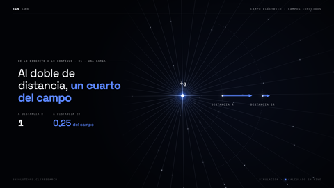 | **Carga puntual y sonda 1/r²** `carga-sonda` | E ∝ 1/r²: rayos radiales con partículas; la flecha a 2r mide un cuarto de la de r | BN_Electromagnetismo = plantilla `E00UnaCarga.tsx: step, sonda` | canvas 2D (lab), voz.json | alta: sonda y rayos sirven para cualquier carga |
| 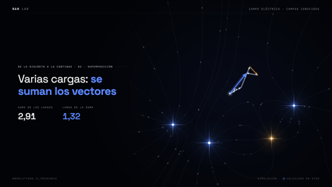 | **Superposición vectorial en P** `superposicion` | E = ΣEᵢ de 3 cargas, punta con cola, resultante y líneas con `trazar` (RK2). Variantes en lineas-de-campo E06 y ley-de-coulomb E11 (fuerzas) | BN_Electromagnetismo = plantilla `E01Superposicion.tsx: step` | canvas 2D (lab), voz.json | alta: patrón repetido en tres videos |
| 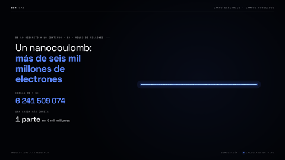 | **Contador de electrones en 1 nC** `electrones-1nc` | 1 nC/e = 6 241 509 074; contador logarítmico; la nube se aplana en barra continua | BN_Electromagnetismo = plantilla `E02Millones.tsx: step` | canvas 2D, voz.json | media: la transición discreto→continuo sirve |
| 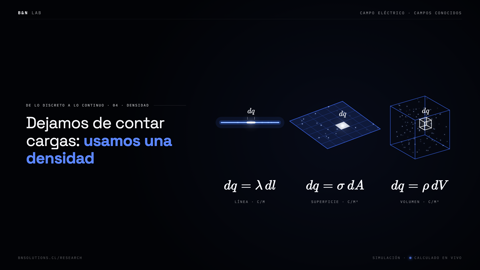 | **Densidades λ, σ, ρ** `densidades` | Línea, superficie 3D y cubo de volumen con el trocito dq latiendo | BN_Electromagnetismo = plantilla `E03Densidad.tsx: lineaCargada, superficie, volumen, cubo` | canvas 2D, proyeccion.ts, KaTeX | alta: las tres distribuciones generales |
|  | **Suma de Riemann que converge** `riemann` | Barra partida en N = 2, 4, 8, 16 cargas (punto medio); la resultante se acerca al campo exacto en la mediatriz | BN_Electromagnetismo = plantilla `E04Riemann.tsx: trozos, step` | canvas 2D, voz.json | alta: ilustra cualquier límite de una suma |
|  | **De la suma a la integral** `suma-integral` | Σ kΔq/r² → ∫ k dq/r², líneas de una barra de 40 cargas | BN_Electromagnetismo = plantilla `E05Integral.tsx: step` | canvas 2D, KaTeX | media: la barra con líneas es genérica |
| 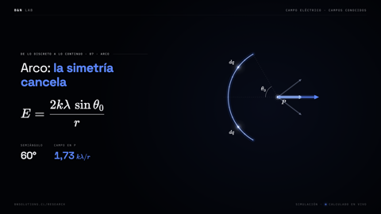 | **Arco: la simetría cancela** `arco` | E = 2kλ sinθ₀/r; pares simétricos cancelan; el arco se vuelve anillo y E = 0 al centro | BN_Electromagnetismo = plantilla `E06Arco.tsx: arcoLuz, step` | canvas 2D, KaTeX | media: `arcoLuz` es reutilizable |
| 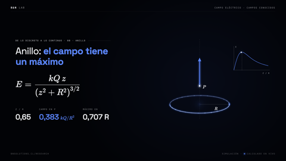 | **Anillo en 3D con gráfico E(z)** `anillo-ez` | E = kQz/(z²+R²)^{3/2}; P recorre el eje; de lejos tiende a kQ/z² | BN_Electromagnetismo = plantilla `E07Anillo.tsx: grafico, step` | canvas 2D, proyeccion.ts, KaTeX | alta: 3D más gráfico vivo |
| 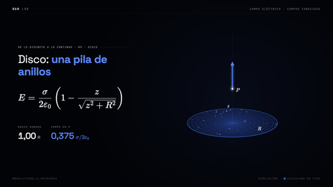 | **Disco como pila de anillos** `disco` | E = σ/2ε₀·(1 − z/√(z²+R²)); malla en perspectiva que se llena anillo por anillo | BN_Electromagnetismo = plantilla `E08Disco.tsx: step` | canvas 2D, proyeccion.ts (mallaDisco), KaTeX | alta: malla 3D general |
| 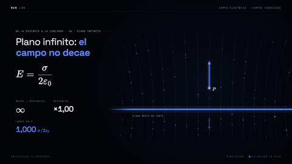 | **Plano infinito visto de canto** `plano-infinito` | El segmento crece sin límite y E = σ/2ε₀ queda constante | BN_Electromagnetismo = plantilla `E09Plano.tsx: step` | canvas 2D, KaTeX | media: sirve para placas |
| 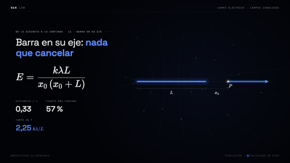 | **Barra en su eje** `barra-eje` | Aportes ∝ 1/d² apilados; E = kλL/(x₀(x₀+L)) | BN_Electromagnetismo = plantilla `E10BarraEje.tsx: step` | canvas 2D, KaTeX | media: apilado de aportes |
| 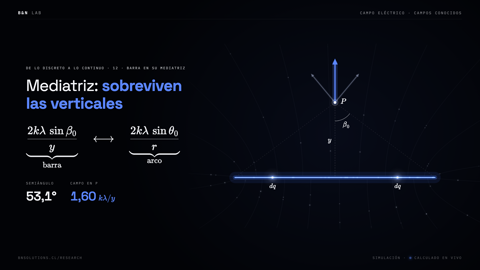 | **Barra en la mediatriz** `barra-mediatriz` | Las horizontales se cancelan; E = 2kλ sinβ₀/y | BN_Electromagnetismo = plantilla `E11Mediatriz.tsx: step` | canvas 2D, KaTeX | media |
| 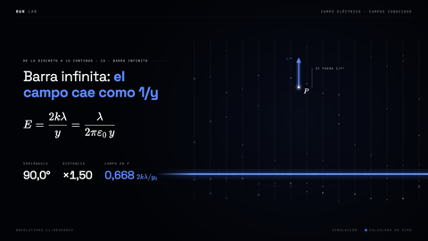 | **Barra infinita** `barra-infinita` | β₀ → 90°: E = 2kλ/y frente a un fantasma 1/y² | BN_Electromagnetismo = plantilla `E12BarraInfinita.tsx: step` | canvas 2D, KaTeX | media: compara leyes de decaimiento |
| 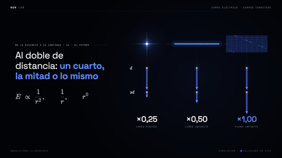 | **Patrón 1/r², 1/r, r⁰** `patron-1r` | Punto, línea y plano en 3D, cada uno con sonda a doble distancia | BN_Electromagnetismo = plantilla `E13Patron.tsx: plano, sonda, step` | canvas 2D, proyeccion.ts, KaTeX | alta: resumen visual muy claro |
| 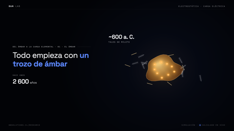 | **Ámbar frotado atrae plumas** `ambar` | Electrización por frotamiento: aparecen cargas − y vuelan plumas y pajitas | del-ambar-a-millikan `E00Ambar.tsx: step, pluma, pajita` | canvas 2D, voz.json | baja: narrativa específica |
| 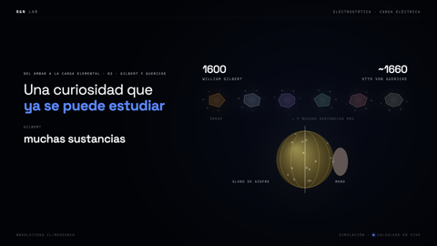 | **Muestras de Gilbert y globo de Guericke** `guericke` | Esfera de azufre girando que acumula carga y chispas | del-ambar-a-millikan `E01Guericke.tsx: poligono, step` | canvas 2D | media: esfera giratoria vistosa |
| 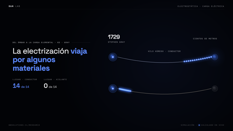 | **Gray: carga que viaja por un hilo** `gray-hilo` | Conductores y aislantes: cargas que recorren un hilo hasta una esfera | del-ambar-a-millikan `E02Gray.tsx: step` | canvas 2D | media: conducción |
| 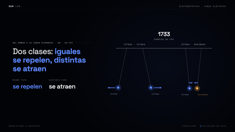 | **Péndulos de Du Fay** `dufay` | Iguales se repelen, distintas se atraen, con flechas de fuerza | del-ambar-a-millikan `E03DuFay.tsx: step` | canvas 2D | media: péndulos electrostáticos |
| 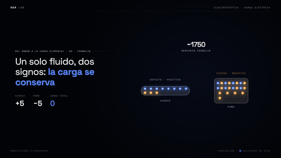 | **Franklin: un solo fluido** `franklin` | Conservación de la carga: negativas pasan del vidrio al paño; carga neta contada | del-ambar-a-millikan `E04Franklin.tsx: step` | canvas 2D | media |
| 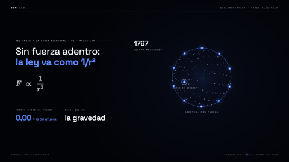 | **Cáscara esférica de Priestley** `priestley` | Teorema de la cáscara: puntos de Fibonacci en 3D, fuerza 1/r² sumada nula adentro | del-ambar-a-millikan `E05Priestley.tsx: step` | canvas 2D, KaTeX | alta: anticipa la ley de Gauss |
| 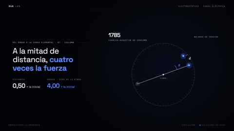 | **Balanza de torsión (historia)** `balanza-cavendish` | θ = θ₀(d₀/d)²; esferas de Cavendish y balanza desde arriba | del-ambar-a-millikan `E06Coulomb.tsx: step` | canvas 2D | media: hay versión dinámica en ley-de-coulomb |
|  | **Dispersión de Rutherford** `rutherford` | Repulsión K/r² integrada con paso adaptativo; una alfa rebota en la lámina | del-ambar-a-millikan `E07Rutherford.tsx: step` | canvas 2D | alta: integrador de trayectorias con estela |
| 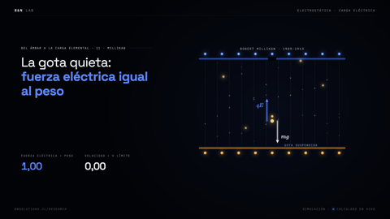 | **Gota de Millikan suspendida** `millikan` | qE = mg; velocidad terminal ∝ mg − qE entre placas | del-ambar-a-millikan `E10Millikan.tsx: step` | canvas 2D, KaTeX | alta: placas y gotas |
| 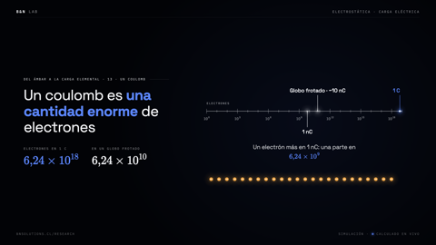 | **Regla logarítmica de electrones** `regla-log` | n = Q/e de 10⁰ a 10¹⁹; una fila discreta se vuelve continua | del-ambar-a-millikan `E12Coulomb.tsx: marca, step` | canvas 2D, KaTeX | media: regla logarítmica genérica |
| 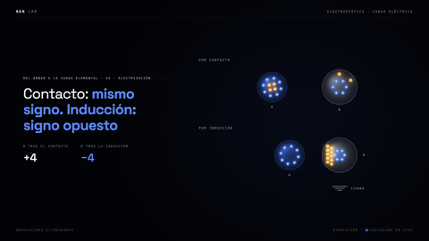 | **Electrización por contacto e inducción** `electrizacion` | Contacto deja el mismo signo; inducción con tierra el opuesto | del-ambar-a-millikan `E13Electrizacion.tsx: step` | canvas 2D, lab/historia.ts | media |
| 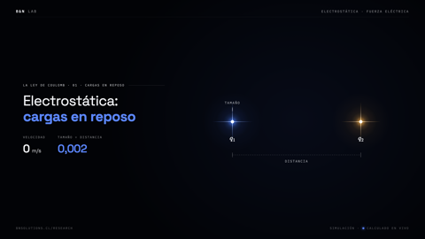 | **De esfera a carga puntual** `esfera-punto` | Tamaño/distancia de 0,30 a 0,002 en escala log: la esfera se vuelve punto | ley-de-coulomb `E00Reposo.tsx: step` | canvas 2D, lab/cargas.ts | media |
| 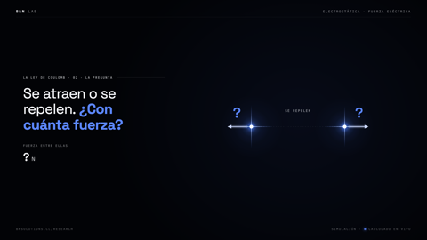 | **¿Atracción o repulsión?** `atrae-repele` | Cambia el signo y se invierten las fuerzas | ley-de-coulomb `E01Pregunta.tsx: step` | canvas 2D | baja: introducción |
| 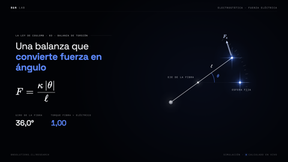 | **Balanza de torsión dinámica** `balanza-dinamica` | κθ = ℓF cos(θ/2), F ∝ 1/d²; giro amortiguado al equilibrio | ley-de-coulomb `E02Balanza.tsx: step` | canvas 2D, KaTeX | alta: oscilador amortiguado real |
| 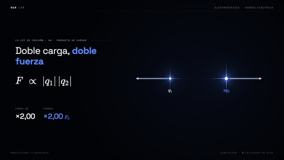 | **Producto de cargas** `producto-cargas` | F ∝ \|q₁\|\|q₂\|: duplicar q₂ duplica F | ley-de-coulomb `E03Producto.tsx: step` | canvas 2D, KaTeX | media |
| 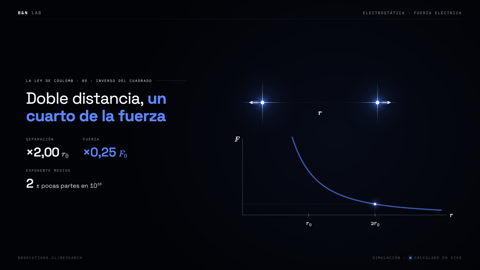 | **Inverso del cuadrado con gráfico** `inverso-cuadrado` | F(r) = F₀/r² dibujándose con un punto que sigue la separación | ley-de-coulomb `E04Cuadrado.tsx: step` | canvas 2D | alta: gráfico vivo genérico |
| 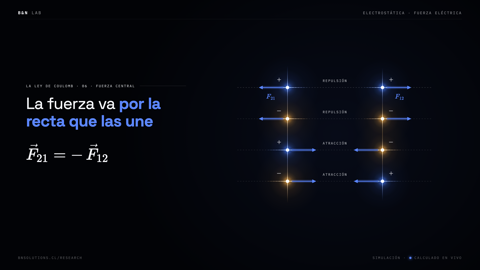 | **Fuerza central y acción-reacción** `central` | F₂₁ = −F₁₂ por la recta que une las cargas | ley-de-coulomb `E05Central.tsx: step` | canvas 2D, KaTeX | media |
| 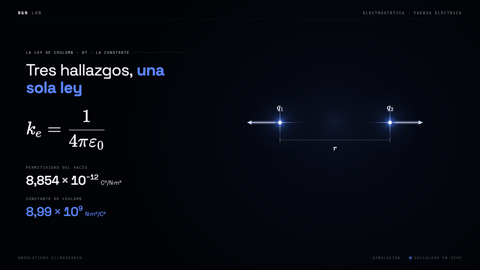 | **Constante k_e** `constante-k` | F = k_e\|q₁q₂\|/r², k_e = 1/4πε₀ | ley-de-coulomb `E06Constante.tsx: step` | canvas 2D, KaTeX | baja: casi solo fórmula |
| 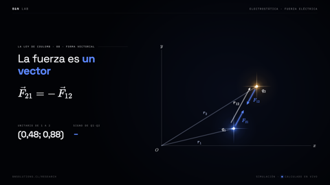 | **Forma vectorial de Coulomb** `forma-vectorial` | F₁₂ = k q₁q₂ (r₂−r₁)/\|r₂−r₁\|³ con q₂ orbitando | ley-de-coulomb `E07Vector.tsx: step` | canvas 2D, KaTeX | alta: vectores posición sobre ejes |
| 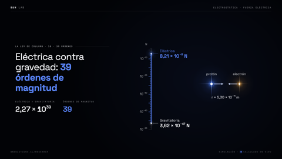 | **39 órdenes de magnitud** `ordenes-39` | Átomo de H: escala log de 10⁻⁵⁰ a 10⁻⁴ N, barra que sube década por década | ley-de-coulomb `E09Ordenes.tsx: step` | canvas 2D, fisica.tsx (CODATA) | alta: escala logarítmica visual |
| 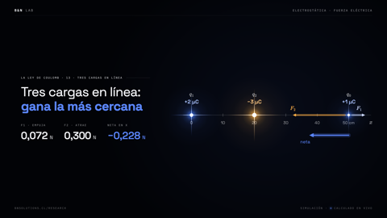 | **Tres cargas en línea** `tres-en-linea` | +2 µC, −3 µC y q₀: fuerzas en x y neta | ley-de-coulomb `E12Linea.tsx: step` | canvas 2D | media: ejercicio 1D |
| 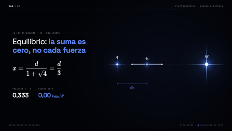 | **Equilibrio entre q y 4q** `equilibrio` | x = d/3; q₀ se acomoda amortiguada | ley-de-coulomb `E13Equilibrio.tsx: step` | canvas 2D, KaTeX | alta: búsqueda visual de equilibrio |
| 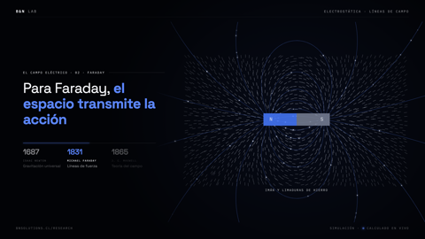 | **Limaduras de Faraday** `faraday-limaduras` | Dipolo: limaduras que caen y se alinean con E, luego líneas con partículas | lineas-de-campo `E01Faraday.tsx: step` | canvas 2D, lab/campo.ts | alta: muy vistoso |
| 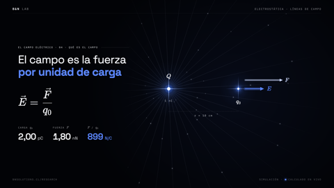 | **Definición E = F/q₀** `definicion-e` | Duplicar q₀ duplica F; E no cambia | lineas-de-campo `E03Definicion.tsx: step` | canvas 2D, KaTeX | media |
| 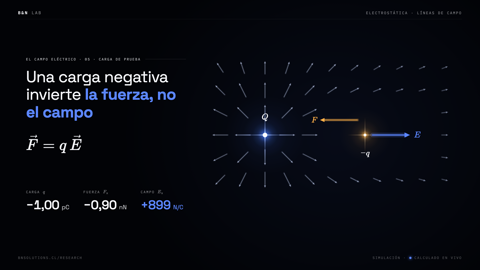 | **Convención de la carga de prueba** `convencion` | F = qE: q₀ negativa invierte F, no E | lineas-de-campo `E04Convencion.tsx: step` | canvas 2D, KaTeX | media |
| 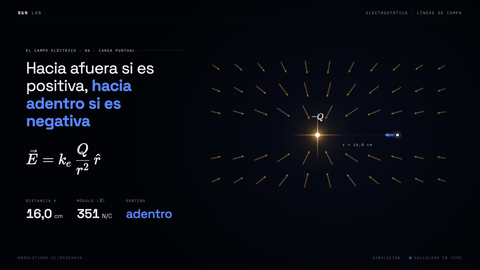 | **Carga puntual ±** `puntual-signo` | E = kQ/r² r̂ hacia afuera o hacia adentro según el signo | lineas-de-campo `E05Puntual.tsx: step` | canvas 2D, KaTeX | alta |
| 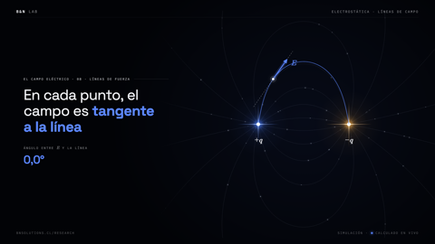 | **Tangente a la línea de campo** `tangente` | Un punto recorre una línea del dipolo; ángulo cuerda-campo calculado | lineas-de-campo `E07Tangente.tsx: step` | canvas 2D, lab/campo.ts | alta |
|  | **Nacen y mueren** `nacen-mueren` | +2q/−q con 12 líneas por unidad; unas vuelven a −q, otras al infinito | lineas-de-campo `E08Reglas.tsx: step` | canvas 2D, lab/campo.ts (lineas) | alta: conteo correcto de líneas |
| 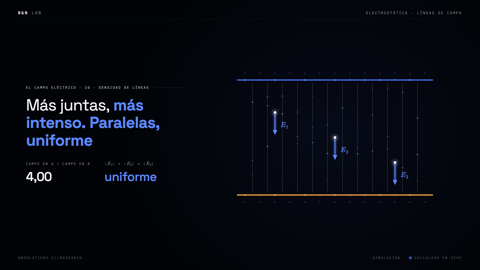 | **Densidad de líneas** `densidad-lineas` | \|E\| ∝ 1/r² y campo uniforme entre placas | lineas-de-campo `E09Densidad.tsx: step` | canvas 2D | media |
| 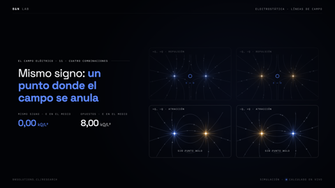 | **Cuatro combinaciones de signos** `cuatro-signos` | ++, +−, −+, −− con el punto nulo como cero de Eₓ | lineas-de-campo `E10Cuatro.tsx: step` | canvas 2D, lab/campo.ts (cerosEje) | alta: rejilla 2×2 de dipolos |
| 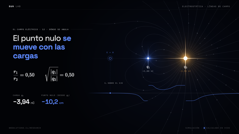 | **El punto nulo se mueve** `punto-nulo` | q₂ variable; líneas recalculadas por cuadro, nulo buscado numéricamente, gráfica de Eₓ | lineas-de-campo `E11Nulo.tsx: step` | canvas 2D, lab/campo.ts, KaTeX | alta: la simulación más rica de la serie |
| 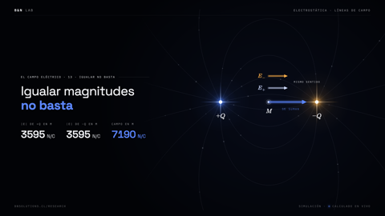 | **Igualar magnitudes no basta** `igualar` | ±Q: en el punto medio los aportes se suman | lineas-de-campo `E12Igualar.tsx: step` | canvas 2D | media |
| 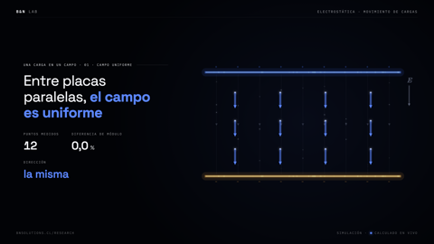 | **Campo uniforme entre placas** `uniforme-placas` | Sondas en grilla 4×3 que miden el mismo vector | carga-en-un-campo `E00Uniforme.tsx: step` | canvas 2D, lab/campo.ts (placas) | alta: pieza base |
| 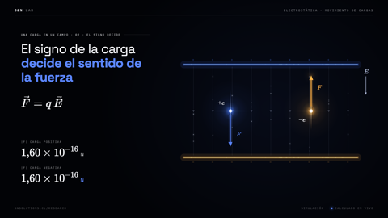 | **El signo decide la fuerza** `signo-fuerza` | F = qE con q = ±e, E = 10³ N/C | carga-en-un-campo `E01Signo.tsx: step` | canvas 2D, KaTeX | media |
| 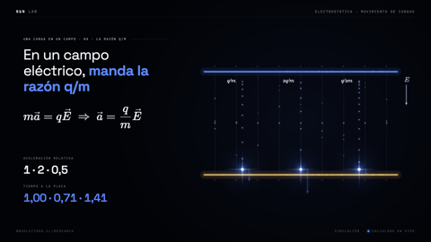 | **Razón q/m** `razon-qm` | a = (q/m)E con razones 1, 2 y ½; t ∝ 1/√a | carga-en-un-campo `E03Razon.tsx: step` | canvas 2D, KaTeX | media |
| 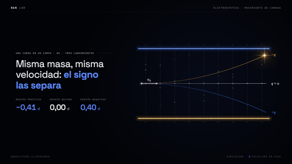 | **Tres lanzamientos +, 0, −** `tres-lanzamientos` | Misma v₀, desvío según el signo | carga-en-un-campo `E04Tres.tsx: step` | canvas 2D, lab/campo.ts (camino, rastro) | alta: trayectorias con rastro |
| 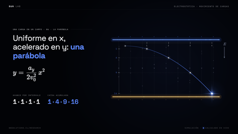 | **Parábola estroboscópica** `estroboscopio` | y = a_y x²/(2v₀²); caídas 1, 4, 9, 16 | carga-en-un-campo `E05Parabola.tsx: step` | canvas 2D, lab/campo.ts (estrobo) | alta: muy didáctico |
| 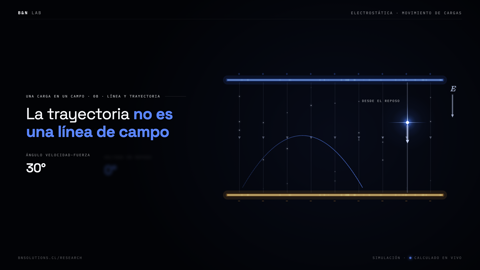 | **La trayectoria no es línea de campo** `trayectoria-no-linea` | Lanzada a 60° frente a soltada en reposo | carga-en-un-campo `E07Trayectoria.tsx: step` | canvas 2D | media |
| 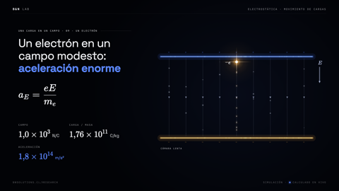 | **Electrón en campo modesto** `electron-campo` | a = eE/mₑ ≈ 1,76×10¹⁴ m/s² | carga-en-un-campo `E08Electron.tsx: step` | canvas 2D, KaTeX | media |
| 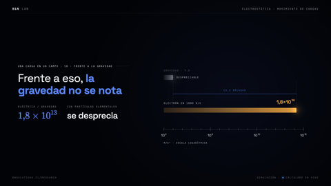 | **Gravedad despreciable** `gravedad-despreciable` | Barras log: g frente a a_E (≈10¹³) | carga-en-un-campo `E09Despreciable.tsx: barra, step` | canvas 2D, lab/campo.ts (potencia) | alta: comparador logarítmico |
|  | **Un centímetro: ns contra ms** `centimetro` | t = √(2d/a): electrón frente a piedra | carga-en-un-campo `E10Centimetro.tsx: step` | canvas 2D | media |
|  | **Gota con dos campos** `gota-dos-campos` | a = g + (q/m)E; equilibrio estilo Millikan | carga-en-un-campo `E11Ambos.tsx: step` | canvas 2D, KaTeX | media |
|  | **λ uniforme a λ(x)** `lambda-x` | Densidad pareja que pasa a rampa αx con el mismo total | densidades-no-uniformes `E00Intro.tsx: step` | canvas 2D, lab/densidad.ts | alta: trazo de densidad variable |
|  | **Receta de siete pasos** `receta` | dq, r y β, dE con componentes, simetría, resultante y revisión | densidades-no-uniformes `E01Receta.tsx: step` | canvas 2D, HTML | alta: método general |
|  | **Componentes, no módulos** `componentes` | Suma vectorial frente a suma de módulos | densidades-no-uniformes `E02Componentes.tsx: step` | canvas 2D | alta: error típico |
|  | **Barra λ = αx y dq** `barra-dq` | dq = αx dx sobre [a, b] | densidades-no-uniformes `E03BarraDq.tsx: step` | canvas 2D, barra.ts, densidad.ts | media |
|  | **Aportes α dx/x** `aportes-dx` | dE = −kα dx/x x̂; ocho trozos apilados | densidades-no-uniformes `E04BarraAportes.tsx: step` | canvas 2D | media |
|  | **Integral de 1/x = logaritmo** `integral-log` | Área bajo 1/x = ln(b/a), verificada contra suma directa | densidades-no-uniformes `E05BarraIntegral.tsx: step` | canvas 2D, densidad.ts (grafico) | alta: área acumulada |
|  | **Revisar b → a** `revisar-limite` | El campo se apaga; Q = α(b²−a²)/2 | densidades-no-uniformes `E06BarraRevisar.tsx: step` | canvas 2D | media |
|  | **Misma carga, otro campo** `misma-carga` | λ = αx frente a uniforme | densidades-no-uniformes `E07BarraUniforme.tsx: barra, step` | canvas 2D | media |
|  | **Semicírculo λ₀ cosθ** `semicirculo` | Q = 2λ₀R, densidad angular | densidades-no-uniformes `E08Semicirculo.tsx: step` | canvas 2D, semi.ts | media |
|  | **Simetría con densidad par** `simetria-par` | ∫ sinθ cosθ dθ = 0: pares ±θ cancelan Eₓ | densidades-no-uniformes `E09Simetria.tsx: step` | canvas 2D | media |
|  | **Barrido de la integral angular** `barrido-angular` | E(P) = −πkλ₀/(2R) ŷ | densidades-no-uniformes `E10SemiIntegral.tsx: step` | canvas 2D | media |
|  | **Fuerza F = qE** `fuerza-qe` | q = −2 µC en P, fuerza opuesta al campo | densidades-no-uniformes `E11Fuerza.tsx: step` | canvas 2D | baja |
|  | **P en movimiento con integral numérica** `mapa-integral-viva` | Integral rehecha cada cuadro; mapa de direcciones en grilla | densidades-no-uniformes `E12OtraHerramienta.tsx: step` | canvas 2D, fisica.ts (campo2En) | alta: mapa de campo en vivo |
|  | **Rayos de campo que se vuelven Lissajous** `v1-rayos-lissajous` | 28 rayos de una carga que se doblan sobre x = R sen(as + π/2), y = R sen(bs), a:b = 3:2 | teaser-lectures @ v1-luminosa `src/escenas.ts: intro (lis, lisAB, giroIntro)` | canvas 2D, ritmo.json | media: transición acoplada |
|  | **Logo vivo: dipolo con partículas** `v1-logo-dipolo` | 220 líneas del dipolo ±q (trazar, RK2) con partículas; el interior de la marca converge. v2: misma física con golpe seco | teaser-lectures @ v1-luminosa `src/escenas.ts: logo, fondoLogo (también v2)` | canvas 2D, marca.json, ritmo.json | alta: dipolo reutilizable |
|  | **Campo de una carga: limaduras → líneas** `v4-limaduras` | Limaduras radiales nota a nota; desde el acorde F, 72 líneas con pulso por nota. Código heredado en teaser-cuerpo (no visible) | teaser-lectures @ v4-lo-invisible `src/escenas.ts: campo (v4, final, cuerpo)` | canvas 2D, ritmo.json | alta: limaduras reales |
|  | **Estallido de carga** `estallido` | Luz de carga como la foto de perfil: halos, núcleo y 110 rayos; versión viva en final.ts (estallidoVivo) | teaser-lectures @ v4-lo-invisible `src/escenas.ts: estallido; src/final.ts: estallidoVivo` | canvas 2D | alta: firma visual de B&N |
|  | **Clímax: campo de dos cargas con LIC** `campo-dos-lic` | Textura LIC del dipolo revelada por golpes, flujo de guiones por 180 líneas, anillos y swell | teaser-lectures @ v4-lo-invisible `src/escenas.ts: clima, campoDos (v4, final)` | canvas 2D, public/img/campo-*.png, ritmo.json | alta: campoDos es el núcleo |
|  | **LIC estática del dipolo** `lic-estatica` | Line integral convolution del campo real ±q, núcleo de Hann L = 70 px, paleta azul | teaser-lectures @ v4-lo-invisible `herramientas/lic.py → public/img/campo-{45,169,916}.png` | numpy, ffmpeg (offline) | alta: ver modulos/lic |
|  | **LIC animada (Cabral-Leedom/Forssell)** `lic-animada` | Núcleo Hann·(1 + m cos(Φ − θ)): hebras que fluyen de +q a −q, loop de 60 cuadros | teaser-lectures @ final-epiciclos (= main) `herramientas/lic_animada.py → public/img/campo-*/fNN.jpg; final.ts: revelacion` | numpy, ffmpeg (offline) | alta: ver modulos/lic |
|  | **Líneas de campo de carga puntual (partículas GPU)** `gpu-campo-puntual` | E radial ∝ q/r²; partículas que fluyen hacia afuera y laten por nota | teaser-cuerpo `src/gpu/glsl/particulas.ts: forma 2` | motor GPU, ritmo.json | alta: forma de partículas en GLSL |
|  | **Dipolo revolucionado en 3D (trazos)** `gpu-dipolo-3d` | Líneas de +q/−q integradas con RK2 y rotadas en torno al eje; pulsos en bombos | teaser-v5 `src/gpu/sims.ts: lineasCampo (v5, v6)` | motor GPU (trazos), análisis de audio | alta: función pura |
|  | **Dipolo en pantalla (partículas GPU)** `gpu-dipolo-pantalla` | Líneas de dos cargas calzadas con la LIC del perfil | teaser-cuerpo `src/gpu/glsl/particulas.ts: forma 14 + datos.ts: datosDipolo (cuerpo, v5)` | motor GPU | alta: datos deterministas |

## Gravedad y órbitas

| Miniatura | Simulación | Qué muestra | Dónde | Depende de | Reutilizable |
|---|---|---|---|---|---|
|  | **Coulomb y Newton** `coulomb-newton` | F_g = Gm₁m₂/r² frente a F_e: masas solo atraen | ley-de-coulomb `E08Newton.tsx: step` | canvas 2D, lab/cargas.ts (masa) | media |
|  | **Carga se cancela, masa suma** `neutra-masa` | Protones y electrones alternados: carga neta 0, masa creciente | ley-de-coulomb `E10Neutra.tsx: step` | canvas 2D | media |
|  | **Acción a distancia** `accion-distancia` | Dos masas se atraen a través del vacío y se vuelven cargas | lineas-de-campo `E00Distancia.tsx: step` | canvas 2D | baja: narrativa |
|  | **Caída libre: todos caen igual** `caida-libre` | ma = mg ⇒ a = g; masas 1, 2 y 4 con estela | carga-en-un-campo `E02Gravedad.tsx: cuerpo, step` | canvas 2D, KaTeX | alta |
|  | **Tiro parabólico g frente a qE/m** `tiro-parabolico` | Proyectil con g al lado de carga con qE/m = g: misma parábola | carga-en-un-campo `E06Tiro.tsx: step` | canvas 2D, KaTeX | alta: pantalla dividida |
|  | **Toro → pozo de Flamm** `flamm-toro` | Toro que se transforma en el paraboloide de Flamm z = 2√(r_s(ρ − r_s)); r_s late con el bombo. v2 austera, v4 por nota, cuerpo heredado | teaser-lectures @ v1-luminosa `src/escenas.ts: espacio, superficie, flamm, rsPozo (v1, v2); gravedad (v4, final)` | canvas 2D, ritmo.json | alta: malla 3D sin dependencias |
|  | **Órbita con precesión** `orbita-precesion` | ρ(φ) = p/(1 + e cos νφ), ν = 0,88: el perihelio avanza ≈ 49° por vuelta; segunda ley de Kepler | teaser-lectures @ v4-lo-invisible `src/escenas.ts: orbita (v1, v2, v4, final)` | canvas 2D | alta: física clara |
|  | **Cono de luz** `cono-luz` | Conos pasado/futuro (c = 1), línea de universo; en v5 con cascarones por bombo | teaser-lectures @ v4-lo-invisible `src/escenas.ts: cono (v4, final); v5 src/gpu/sims.ts: cono` | canvas 2D / motor GPU | alta: geometría simple |
|  | **Tres cuerpos en ocho** `tres-cuerpos` | Coreografía de Chenciner–Montgomery (G = m = 1), Verlet de velocidad (el comentario dice RK4) | teaser-lectures @ v4-lo-invisible `src/escenas.ts: tres (v4, final); v5 src/gpu/sims.ts: tres` | canvas 2D / motor GPU | alta: condiciones exactas |
|  | **Agujero negro** `gpu-hoyo-negro` | Rayos curvados tipo Schwarzschild, disco de acreción con Doppler beaming, esfera de fotones | teaser-cuerpo `src/gpu/glsl/mundos.ts: HOYO (cuerpo, v5, v6)` | motor GPU | alta: mundo raymarcheado |
|  | **Pozo gravitacional (partículas)** `gpu-pozo` | Grilla polar que se hunde; caída kepleriana con rotación | teaser-cuerpo `src/gpu/glsl/particulas.ts: forma 3` | motor GPU | alta |
|  | **Órbita relativista (partículas)** `gpu-orbita-relativista` | Elipse a = 2,3, e = 0,5 con anomalía verdadera; la roseta queda como estela | teaser-cuerpo `src/gpu/glsl/particulas.ts: forma 4 + guion.ts: ORB` | motor GPU | alta |
|  | **Malla espacio-tiempo** `gpu-malla-st` | Grilla hundida en un pozo (los graves lo profundizan), ondas gravitacionales en bombos | teaser-v5 `src/gpu/sims.ts: malla (v5); guion.ts: malla (v6)` | motor GPU (trazos), análisis de audio | alta |

## Ondas

| Miniatura | Simulación | Qué muestra | Dónde | Depende de | Reutilizable |
|---|---|---|---|---|---|
|  | **Maxwell: cambio a velocidad c** `maxwell-c` | Δt = 1 UA/c ≈ 8,3 min: frente anular que viaja a la Tierra | lineas-de-campo `E02Maxwell.tsx: step` | canvas 2D, lab/campo.ts | alta |
|  | **Onda gravitacional de juguete** `onda-bombo` | Pulso gaussiano radial en la malla por bombo | teaser-lectures @ v1-luminosa `src/escenas.ts: ondaBombo (v1, v2)` | ritmo.json | media |
|  | **Epiciclos → onda cuadrada** `fourier-cuadrada` | 4/π Σ sen((2k−1)x)/(2k−1): un término más por pulso. En v5 versión 3D con trazos | teaser-lectures @ v1-luminosa `src/escenas.ts: fourier (v1, v2); v5 src/gpu/sims.ts: ondaCuadrada` | canvas 2D, ritmo.json | alta: Fourier didáctico |
|  | **Interferencia de dos fuentes** `interferencia` | Σ cos(kr − ωt)/√(1 + r/λ) con frente causal; v2 en franjas nítidas; v4 pasa a relieve 3D | teaser-lectures @ v1-luminosa `src/escenas.ts: interferencia (v1, v2); ondaEsc, amplitud (v4, final)` | canvas 2D (ImageData), ritmo.json | alta: ondas reales baratas |
|  | **Interferencia → relieve 3D** `interferencia-relieve` | La misma suma de ondas pasa a una malla en perspectiva con altura = amplitud | teaser-lectures @ v4-lo-invisible `src/escenas.ts: ondaEsc` | canvas 2D, ritmo.json | alta |
|  | **Prisma con dispersión (canvas)** `prisma-snell` | Ley de Snell vectorial, n(λ) = 1,5 + 0,0042/λ² (Cauchy), 7 colores | teaser-lectures @ v4-lo-invisible `src/escenas.ts: prisma, refracta (v4, final)` | canvas 2D | alta: óptica real |
|  | **Superficie de interferencia iridiscente** `gpu-ondas-iridiscentes` | Dos fuentes coherentes sobre una superficie con película delgada real | teaser-cuerpo `src/gpu/glsl/mundos.ts: ONDAS + particulas.ts: forma 5` | motor GPU | alta |
|  | **Prisma raymarcheado** `gpu-prisma` | Haz blanco, vidrio con Fresnel y abanico espectral (Zucconi CIE) | teaser-cuerpo `src/gpu/glsl/mundos.ts: PRISMA (cuerpo, v5)` | motor GPU | alta: muy vistoso |
|  | **Membrana: ecuación de onda 2D (FDTD)** `fdtd-membrana` | ∂²h/∂t² = c²∇²h con esponja absorbente; gotas en bombos y dos fuentes coherentes | teaser-v6 (en desarrollo) `herramientas/simular.py: onda → public/sim/onda; glsl/sim2d.ts` | datos precalculados en public/sim, ritmo.json | media: atado a la canción |

## Fluidos

| Miniatura | Simulación | Qué muestra | Dónde | Depende de | Reutilizable |
|---|---|---|---|---|---|
|  | **Fluido curl-noise (partículas)** `gpu-curl-noise` | Líneas de traza transportadas por el rotacional de un ruido | teaser-cuerpo `src/gpu/glsl/particulas.ts: forma 7 (cuerpo, v5)` | motor GPU | alta: sin precálculo |
|  | **Stable fluids de Stam (vía Madelung)** `stable-fluids` | Navier-Stokes incompresible 2D, MacCormack, proyección espectral, confinamiento de vorticidad; nace de ψ | teaser-v6 (en desarrollo) `herramientas/simular.py: fluido → public/sim/fluido` | datos precalculados en public/sim | media: encadenado al estado cuántico |

## Cuántica

| Miniatura | Simulación | Qué muestra | Dónde | Depende de | Reutilizable |
|---|---|---|---|---|---|
|  | **Zoom del átomo al núcleo** `zoom-atomo` | Razón de radios 10⁵; zoom log de 10⁻¹⁰ a 10⁻¹⁴ m | del-ambar-a-millikan `E08Escala.tsx: step` | canvas 2D, KaTeX | alta: zoom de potencias de diez |
|  | **Colapso clásico y órbitas de Bohr** `bohr` | Espiral con ω ∝ r^{-3/2} y anillos de radiación; luego órbitas estacionarias | del-ambar-a-millikan `E09Bohr.tsx: step` | canvas 2D | alta |
|  | **Cuantización Q = ne** `cuantizacion` | Gotas que se apilan en múltiplos de e | del-ambar-a-millikan `E11Multiplos.tsx: step` | canvas 2D, KaTeX | media |
|  | **Doble rendija** `doble-rendija` | 2400 impactos de I ∝ cos²(9πy)·sinc²(2,2πy) muestreados por CDF inversa; en v5 con trazos | teaser-lectures @ v4-lo-invisible `src/escenas.ts: rendija (v4, final); v5 src/gpu/sims.ts: rendija` | canvas 2D, ritmo.json | alta: cuántica icónica |
|  | **Orbital 3d_z² del hidrógeno** `orbital-3dz2` | \|ψ\|² ∝ r⁴e^{−2r/3}(3cos²θ − 1)² por muestreo de rechazo; versión GPU volumétrica | teaser-lectures @ v4-lo-invisible `src/escenas.ts: orbital (v4, final); src/gpu/glsl/mundos.ts: ORBITAL (cuerpo, v5)` | canvas 2D / motor GPU | alta |
|  | **Schrödinger 2D split-step** `schrodinger` | iψₜ = −½∇²ψ + Vψ: paquete gaussiano contra doble rendija finita (difracción y túnel) | teaser-v6 (en desarrollo) `herramientas/simular.py: schro → public/sim/schro` | datos precalculados en public/sim | media |

## Caos

| Miniatura | Simulación | Qué muestra | Dónde | Depende de | Reutilizable |
|---|---|---|---|---|---|
|  | **Atractor de Lorenz** `lorenz` | σ = 10, ρ = 28, β = 8/3, RK4 de 6500 pasos; v2 con cortes de cámara; v4: 1300 condiciones iniciales que el flujo ordena | teaser-lectures @ v1-luminosa `src/escenas.ts: lorenz (v1, v2, v4, final)` | canvas 2D, ritmo.json | alta: clásico determinista |
|  | **Lorenz desde ruido** `lorenz-nube` | 1300 condiciones iniciales integradas con RK4 que convergen al atractor | teaser-lectures @ v4-lo-invisible `src/escenas.ts: lorenz (v4, final)` | canvas 2D | alta |
|  | **Título CAOS hecho de trayectorias** `caos-titulo` | Cada punto de la palabra viaja por un tramo del atractor y aterriza en las letras | teaser-lectures @ v2-oscura-titulos `src/escenas.ts: tituloCaos + titulos.ts: grillaPuntos` | canvas 2D, ritmo.json | alta: partículas que forman texto |
|  | **Atractor de Lorenz con un millón de partículas** `gpu-lorenz` | RK4, 1024² muestras en textura; v5 además como trazo que se dibuja; v6 dos trayectorias que divergen | teaser-cuerpo `src/gpu/datos.ts: datosLorenz + particulas.ts: forma 8; v5 sims.ts: lorenzTrazo` | motor GPU | alta |

## Fractales

| Miniatura | Simulación | Qué muestra | Dónde | Depende de | Reutilizable |
|---|---|---|---|---|---|
|  | **Mandelbrot con zoom** `mandelbrot-v1` | z ↦ z² + c con escape suavizado, zoom de 2,4 a 2e-4 hacia el valle de los caballitos de mar; v4 zoom hasta 4e-6 que se parte hacia las cargas | teaser-lectures @ v1-luminosa `src/escenas.ts: mandelbrot (v1, v2); fractal (v4, final)` | canvas 2D (ImageData), ritmo.json | alta: render por píxel parametrizable |
|  | **Mandelbrot enmascarado por MATEMÁTICA** `mandelbrot-mascara` | El fractal dentro de la palabra, invertido o en negativo según el pulso | teaser-lectures @ v2-oscura-titulos `src/escenas.ts: mandelbrot, modoMandel` | canvas 2D, ritmo.json | alta: máscara tipográfica |
|  | **Espiral áurea** `espiral-aurea` | Cuadrados de Fibonacci y cuartos de círculo; en v5 zoom ×φ por bombo | teaser-lectures @ v4-lo-invisible `src/escenas.ts: aurea (v4, final); v5 src/gpu/sims.ts: aurea` | canvas 2D / motor GPU | alta |
|  | **Mandelbrot zoom profundo (GPU)** `gpu-mandelbrot` | Iteraciones suaves, orbit traps, relieve por estimador de distancia, 8 paletas | teaser-cuerpo `src/gpu/glsl/mundos.ts: FRACTAL (cuerpo, v5)` | motor GPU | alta |
|  | **Conjunto de Julia** `julia` | z → z² + c con c que avanza un paso por pulso | teaser-v6 (en desarrollo) `src/gpu/glsl/sim2d.ts: JULIA + guion.ts` | motor GPU, ritmo.json | alta: shader pequeño |
|  | **Gray-Scott (reacción-difusión)** `gray-scott` | F = 0,055, k = 0,062 («coral»), sembrado con la tinta del fluido | teaser-v6 (en desarrollo) `herramientas/simular.py: gs → public/sim/gs` | datos precalculados en public/sim | media |

## Geometría y topología

| Miniatura | Simulación | Qué muestra | Dónde | Depende de | Reutilizable |
|---|---|---|---|---|---|
|  | **Lissajous → círculo** `lissajous-circulo` | a:b de 3:2 a 1:1 con un punto que recorre la curva | teaser-lectures @ v1-luminosa `src/escenas.ts: intro, lisAB` | canvas 2D, ritmo.json | alta |
|  | **Teseracto 4D** `teseracto` | 16 vértices (±1)⁴, rotación en XW e YZ, proyección 1/(3 − w); v2 austero; v5 con trazos | teaser-lectures @ v1-luminosa `src/escenas.ts: teseracto (v1, v2); v5 src/gpu/sims.ts: teseracto` | canvas 2D / motor GPU | alta |
|  | **Hélice de ADN** `adn` | Doble hélice con desfase 0,8π y pares de bases por nota; versión de partículas en GPU | teaser-lectures @ v4-lo-invisible `src/escenas.ts: adn (v4, final); particulas.ts: forma 10 (cuerpo, v5)` | canvas 2D / motor GPU | media |
|  | **Cinta de Möbius** `mobius` | x = (1 + v cos(u/2)) cos u, y = (1 + v cos(u/2)) sen u, z = v sen(u/2) | teaser-lectures @ v4-lo-invisible `src/escenas.ts: mobius (v4, final)` | canvas 2D | alta |
|  | **Proyección 3D sencilla** `proyeccion-3d` | Cámara con giro y elevación; circunferencias delante/detrás; anillo y malla de disco | BN_Electromagnetismo = plantilla `src/lab/proyeccion.ts (los 7 proyectos)` | canvas 2D | alta: 3D barato |
|  | **Epiciclos de Fourier (intro)** `gpu-epiciclos-intro` | z(s) = Σ a e^{i(fs+p)}: Lissajous, rosas y elipse que se vuelve órbita | teaser-v5 `src/gpu/sims.ts: epiciclos, lissajous, rosa, elipse` | motor GPU (trazos) | alta |
|  | **Nudo de Lissajous 3D** `gpu-nudo` | (cos(nₓs + φₓ), cos(n_y s + φ_y), cos(n_z s)) con color espectral | teaser-v5 `src/gpu/sims.ts: nudo` | motor GPU (trazos) | alta |
|  | **Toro de vidrio iridiscente** `gpu-toro` | Toro raymarcheado con película delgada; la red se proyecta encima | teaser-cuerpo `src/gpu/glsl/mundos.ts: TORO (cuerpo, v5)` | motor GPU | alta |
|  | **Túnel de zoom** `gpu-tunel` | Puntos en streaming (inmersión) | teaser-cuerpo `src/gpu/glsl/particulas.ts: forma 13` | motor GPU | media: transición genérica |

## Computación e IA

| Miniatura | Simulación | Qué muestra | Dónde | Depende de | Reutilizable |
|---|---|---|---|---|---|
|  | **Red neuronal que crece** `red-neuronal` | MLP tanh 3-6-8-6-2, una capa por palma, forward por pulso; en v5 6-10-14-14-10-6 con trazos | teaser-lectures @ v1-luminosa `src/escenas.ts: red, pasada (v1, v2); v5 src/gpu/sims.ts: red` | canvas 2D, ritmo.json | alta: forward real |
|  | **Título COMPUTACIÓN escrito por la red** `computacion-titulo` | Matriz de puntos escrita columna a columna por las salidas de la red | teaser-lectures @ v2-oscura-titulos `src/escenas.ts: tituloComputacion` | canvas 2D, ritmo.json | media |
|  | **Descenso de gradiente con momento** `gradiente` | Pérdida cuadrática anisótropa, heavy-ball v = 0,75v − 0,05∇L | teaser-lectures @ v4-lo-invisible `src/escenas.ts: gradiente (v4, final, cuerpo)` | canvas 2D | alta: optimización explicable |
|  | **Dijkstra en grilla** `dijkstra` | Grilla 30×18 con 22 % de muros: frente de distancias y camino mínimo; v5 con trazos | teaser-lectures @ v4-lo-invisible `src/escenas.ts: dijkstra (v4, final); v5 src/gpu/sims.ts: dijkstra` | canvas 2D / motor GPU | alta |
|  | **Espiral de Ulam** `ulam` | Criba de Eratóstenes; los primos se encienden en la espiral | teaser-lectures @ v4-lo-invisible `src/escenas.ts: ulam (v4, final); v5 src/gpu/sims.ts: ulam` | canvas 2D / motor GPU | alta |

## Probabilidad

| Miniatura | Simulación | Qué muestra | Dónde | Depende de | Reutilizable |
|---|---|---|---|---|---|
|  | **Tablero de Galton** `galton` | Caminos binomiales en 12 filas; los contenedores dibujan la normal N(6, √3); v5 con trazos | teaser-lectures @ v4-lo-invisible `src/escenas.ts: galton (v4, final); v5 src/gpu/sims.ts: galton` | canvas 2D, ritmo.json | alta: autocontenido |
|  | **Modelo de Ising 2D** `ising` | Metropolis en tablero bajo T crítica con campo creciente: se ordena | teaser-v6 (en desarrollo) `herramientas/simular.py: ising → public/sim/ising` | datos precalculados en public/sim | media |

## Tipografía y créditos

| Miniatura | Simulación | Qué muestra | Dónde | Depende de | Reutilizable |
|---|---|---|---|---|---|
|  | **Línea de tiempo Newton/Faraday/Maxwell** `linea-tiempo` | Hitos 1687/1831/1865 que se encienden | lineas-de-campo `src/escenas/Linea.tsx: LineaTiempo` | HTML | alta: componente genérico |
|  | **Título palabra por palabra, HUD y fórmulas** `titulo-palabras` | Entrada con desenfoque, HUD de lecturas vivas, KaTeX que se enfoca (Titulo, Hud, Formula) | BN_Electromagnetismo = plantilla `src/comun.tsx: Titulo, Hud; src/formula.tsx: Formula, resalta` | HTML, KaTeX | alta |
|  | **Tipografía cinética, HUD y cromo (v1)** `v1-tipografia` | Líneas letra a letra, mono que se decodifica, HUD con valores vivos | teaser-lectures @ v1-luminosa `src/Video.tsx: Linea, Codigo, Hud, Textos, Cromo` | ritmo.json | alta |
|  | **Tarjeta con clips de la serie** `v1-tarjeta-clips` | La onda aplanada se vuelve el borde de una tarjeta con 4 clips | teaser-lectures @ v1-luminosa `src/escenas.ts: tarjeta + Video.tsx: Tarjeta` | public/clips, ritmo.json | baja |
|  | **Título FÍSICA curvado por el pozo** `fisica-titulo` | Cada franja de la palabra baja según la profundidad de Flamm | teaser-lectures @ v2-oscura-titulos `src/escenas.ts: tituloFisica` | canvas 2D, ritmo.json | alta: texto deformado por campo |
|  | **Título GEOMETRÍA armado con aristas** `geometria-titulo` | Tramos de la palabra que salen de las aristas del teseracto | teaser-lectures @ v2-oscura-titulos `src/escenas.ts: tituloGeometria + titulos.ts: tramos` | canvas 2D, ritmo.json | media |
|  | **Créditos de la intro (v2)** `v2-creditos` | «Nicolás Moreno», «Benjamín Campos», «Presentan», «Ideas complejas, animadas.» | teaser-lectures @ v2-oscura-titulos `src/Video.tsx: Nombre, Intro, Rebanadas, Decodifica` | ritmo.json | media |
|  | **Capítulos, registro y cromo técnico** `v2-capitulos` | Numeración, anotaciones vivas, marcas de registro, timecode y BAR/BPM | teaser-lectures @ v2-oscura-titulos `src/Video.tsx: Capitulo, Registro, Cromo` | ritmo.json | alta |
|  | **Invitado con clips dentro de las letras** `invitado` | «JAVIER PATIÑO» como máscara de video; sello «INVITADO ESPECIAL» | teaser-lectures @ v2-oscura-titulos `src/Video.tsx: Invitado` | public/clips, ritmo.json | media |
|  | **Rasterizador de títulos** `rasterizador` | Texto a imagen, puntos interiores y tramos, con caché | teaser-lectures @ v2-oscura-titulos `src/titulos.ts: rasterizar, tamPara, grillaPuntos, tramos (v2, v4, final, cuerpo)` | canvas 2D | alta: base de texto de partículas |
|  | **Frase hecha de limaduras** `frase-limaduras` | «Hay cosas que no se ven.»: segmentos que se ordenan en las letras y se fijan en un golpe | teaser-lectures @ v4-lo-invisible `src/escenas.ts: frase1, rasterFrase` | canvas 2D, ritmo.json | alta |
|  | **Frase rellena de campo** `frase-campo` | «Hasta que las ves moverse.»: letras rellenas con la LIC y su flujo | teaser-lectures @ v4-lo-invisible `src/escenas.ts: frase2, palabrasFrase2 (v4, final, cuerpo)` | public/img/campo-*.png, ritmo.json | alta |
|  | **Créditos tipo billing block** `creditos-billing` | Creado por / Con / Invitado especial, con barrido de luz; v5/v6 con reglas en golpes reales | teaser-lectures @ v4-lo-invisible `src/Video.tsx: Creditos (v4, cuerpo, v5, v6)` | ritmo.json / análisis de audio | alta: componente React |
|  | **Texto refractado y disuelto por la simulación** `gpu-texto-refractado` | Glifos que la GPU refracta según el gradiente del campo y disuelve | teaser-v6 (en desarrollo) `src/gpu/texto.ts + glsl/sim2d.ts: TEXTO, VELO` | motor GPU, public/sim | alta: sirve sobre cualquier campo |
|  | **Rótulos mono y variables KaTeX en el canvas** `rotulos-canvas` | rotulo, variable, puntoP, angulo, flecha | BN_Electromagnetismo = plantilla `src/lab/luz.ts` | canvas 2D, public/fonts | alta |

## Finales y logo

| Miniatura | Simulación | Qué muestra | Dónde | Depende de | Reutilizable |
|---|---|---|---|---|---|
|  | **Cierres de la serie con créditos** `cierre-serie` | Barra + que termina en una carga −, créditos MIT y logo; variantes por video (dipolo, placas, fila, densidad) | BN_Electromagnetismo = plantilla `E14Cierre.tsx: step, Creditos, Logo (y E12/E13/E14 de cada video)` | canvas 2D, public/img/bn-logo.png | alta |
|  | **Cierre dipolo y tres propiedades** `cierre-ambar` | Signos, cuantizada, se conserva | del-ambar-a-millikan `E14Cierre.tsx` | canvas 2D | alta |
|  | **Cierre placas con carga** `cierre-lineas` | Campo uniforme y carga + quieta | lineas-de-campo `E13Cierre.tsx` | canvas 2D | alta |
|  | **Cierre de discreto a continuo** `cierre-carga` | La fila de cargas se multiplica hasta ser línea | carga-en-un-campo `E12Cierre.tsx: fila, step` | canvas 2D | alta |
|  | **Cierre barra con densidad variable** `cierre-dens` | Líneas más juntas donde hay más carga | densidades-no-uniformes `E13Cierre.tsx` | canvas 2D, densidad.ts | alta |
|  | **Cierre dipolo (Coulomb)** `cierre-coulomb` | Líneas de + a −; créditos | ley-de-coulomb `E14Cierre.tsx` | canvas 2D | alta |
|  | **Fondo con viñeta y cromo B&N LAB** `marco-cromo` | Viñeta azulada, marca y tema, punto «Calculado en vivo» | BN_Electromagnetismo = plantilla `src/Marco.tsx: Fondo, Cromo` | HTML, serie.ts | alta |
|  | **Epiciclos que dibujan la marca (v1)** `epiciclos-marca-v1` | DFT de los 5 contornos de B&N, 80 epiciclos por contorno; v2 en trazo blanco | teaser-lectures @ v1-luminosa `src/escenas.ts: marca, COEFS, evalua (v1, v2)` | marca.json, ritmo.json | alta: cualquier contorno vectorizado |
|  | **Dispersión del trazo** `dispersion-trazo` | El contorno se suelta en partículas antes del drop | teaser-lectures @ v1-luminosa `src/escenas.ts: dispersion` | marca.json | media |
|  | **Logo y «Próximamente» (v1, v2)** `logo-v1` | bn-mark.png con blur, LECTURES letra a letra, web | teaser-lectures @ v1-luminosa `src/Video.tsx: Logo (v1, v2)` | public/img/bn-mark.png, ritmo.json | media |
|  | **Logo sobre el campo (v4)** `logo-v4` | campoDos con estallidos, LECTURES por nota, «Próximamente» | teaser-lectures @ v4-lo-invisible `src/escenas.ts: logo + Video.tsx: Logo` | public/img/campo-*.png, bn-mark.png | alta: fiel a la foto de perfil |
|  | **Final: epiciclos de la marca (versión aprobada)** `final-epiciclos` | DFT completa de cada contorno, 30 círculos por cadena, estela, cierre por semicorchea, empuje de cámara | teaser-lectures @ final-epiciclos (= main) `src/final.ts: epiciclos, CURVAS, PLAN, componer (final, v5; v6 modificado)` | marca.json, ritmo.json | alta: ver modulos/final-epiciclos |
|  | **Final: partículas que convergen en el logo** `final-particulas` | 5200 partículas; P = C + Rot(θ)[A + E], un solo giro, smootherstep hasta los píxeles de bn-mark | teaser-lectures @ final-epiciclos (= main) `src/final.ts: nubes, metasDesdeImagen, posicion` | marca.json, bn-mark.png, ritmo.json | alta: morph sin saltos |
|  | **Final: logo nítido, LECTURES y revelación del campo** `final-logo` | La LIC animada se abre desde las cargas; LECTURES letra a letra, «Próximamente», web | teaser-lectures @ final-epiciclos (= main) `src/final.ts: revelacion, NOTAS_LECTURES + Video.tsx: Logo` | public/img/campo-*/fNN.jpg, ritmo.json | alta |
|  | **Extractor de la marca** `marca-extractor` | Alfa de bn-mark.png → contornos (BFS) y puntos interiores normalizados | teaser-lectures @ v1-luminosa `herramientas/marca.py → src/marca.json (todas las versiones)` | numpy, ffmpeg (offline) | alta: vectoriza cualquier logo |
|  | **Punto de luz génesis** `gpu-luz-genesis` | Fuente con halo, streak anamórfico, espigas de difracción y anillo de lente | teaser-cuerpo `src/gpu/glsl/mundos.ts: LUZ (cuerpo, v5)` | motor GPU | alta |

## Motores y efectos de postproceso

| Miniatura | Simulación | Qué muestra | Dónde | Depende de | Reutilizable |
|---|---|---|---|---|---|
|  | **Motor de simulación canvas de la serie** `motor-canvas-serie` | step(ctx, w, h, t) puro; adapta a 4:5, 16:9 y 9:16 | BN_Electromagnetismo = plantilla `src/lab/motor.tsx: Simulacion (los 7)` | canvas 2D | alta: ver modulos/lab-serie |
|  | **Motor de luz (brillo, carga, chispa, partículas, trazar)** `motor-luz` | Primitivas aditivas y líneas de campo RK2 de cargas puntuales | BN_Electromagnetismo = plantilla `src/lab/luz.ts (serie y teasers; lineas-de-campo modificado)` | canvas 2D | alta: base de todo |
|  | **Helpers propios de cada video** `helpers-lab-extra` | campo.ts (lineas, cerosEje / placas, estrobo), densidad.ts, historia.ts, cargas.ts | lineas-de-campo `src/lab/campo.ts, densidad.ts, historia.ts, cargas.ts` | canvas 2D | alta |
|  | **Transiciones entre escenas y layouts** `transiciones-serie` | Fundido, salida con desenfoque y escala; reparto 16:9 / 9:16 | BN_Electromagnetismo = plantilla `src/comun.tsx: Escena, Horizontal, Alto` | HTML | alta |
|  | **Render por tramos y revisión** `pipeline-render` | render.py por tramos con reintentos, cuadros.mjs, hoja.py, parte.mjs | BN_Electromagnetismo = plantilla `herramientas/*` | Remotion renderer, ffmpeg | alta: pipeline copiable |
|  | **Warp de estrellas en el riser** `warp` | Starfield con velocidad 0,15 + 1,6u² | teaser-lectures @ v1-luminosa `src/escenas.ts: warp (v1, v2)` | ritmo.json (risers) | alta |
|  | **Explosión del teseracto** `explosion-teseracto` | Aristas despedidas con desenfoque de movimiento de 3 muestras | teaser-lectures @ v1-luminosa `src/escenas.ts: explosion` | canvas 2D, ritmo.json | media |
|  | **Aberración cromática, grano y destello** `aberracion-grano` | Separación rojo/cian por impacto, 4 texturas de grano, flash en drops; v4 solo grano y viñeta | teaser-lectures @ v1-luminosa `src/Video.tsx: Lienzo, Destello (v1, v2, v4, final)` | ritmo.json | alta: drop-in |
|  | **Glitch digital** `glitch` | Separación RGB, bloques desplazados y scanlines por 3 cuadros | teaser-lectures @ v2-oscura-titulos `src/Video.tsx: Lienzo (glitchEn)` | ritmo.json | alta: determinista |
|  | **Deriva de cámara del cierre** `deriva-camara` | Push-in de 3 % desde la convergencia | teaser-lectures @ final-epiciclos (= main) `src/final.ts: derivaCierre` | ritmo.json | alta |
|  | **Verificación de trayectorias** `verificar-trayectorias` | Aceleraciones máxima y media por cuadro para probar que no hay saltos | teaser-lectures @ final-epiciclos (= main) `src/final.ts: verificarTrayectorias` | — | media: QA de animación |
|  | **Motor GPU WebGL2** `motor-gpu` | Búfer HDR, mundos de pantalla completa, 2^20 partículas, trazos instanciados | teaser-v5 `src/gpu/motor.ts, Cuerpo.tsx (cuerpo ⊂ v5 ⊂ v6)` | WebGL2 (ANGLE) | alta: ver modulos/motor-gpu |
|  | **Bloom de doble filtro y grade final** `gpu-bloom-grade` | Bloom de 6 mips (Karis), ACES, aberración, grano, viñeta, dithering, colapso a azul B&N | teaser-v5 `src/gpu/glsl/post.ts: BLOOM_DOWN, BLOOM_UP, FINAL` | motor GPU | alta |
|  | **Onda de choque y flash por golpe** `gpu-choque-flash` | Anillo refractivo por bombo y flash de color por caja | teaser-v5 `src/gpu/glsl/post.ts: FINAL (uChoque, uFlashCol)` | motor GPU, análisis de audio | alta |
|  | **Nebulosa de fondo y partículas con bokeh** `gpu-nebula-bokeh` | Fondo cromático por mundo; un millón de puntos HDR con profundidad de campo y morph | teaser-cuerpo `src/gpu/glsl/mundos.ts: NEBULA; particulas.ts: PART_VS/PART_FS` | motor GPU | alta |
|  | **Trazos instanciados con perfil gaussiano** `gpu-trazos` | Segmentos 3D como quads con sección gaussiana; base de todos los sims de v5 | teaser-v5 `src/gpu/trazos.ts` | motor GPU | alta |

## Música y análisis de audio

| Miniatura | Simulación | Qué muestra | Dónde | Depende de | Reutilizable |
|---|---|---|---|---|---|
|  | **Música de la serie (numpy)** `musica-serie` | 92 BPM, Dm7–B♭maj7–Fmaj7–C, pad, bajo, arpegio; sfx sintetizados; ducking bajo la voz | BN_Electromagnetismo = plantilla `audio/generar_musica.py; src/Video.tsx: habla` | public/musica.wav, public/sfx, voz.json | alta: sin samples de terceros |
|  | **Voz y sincronía por palabra** `voz-sincronia` | edge-tts es-CL-LorenzoNeural; palabras.json; w(escena, palabra) ancla animaciones | BN_Electromagnetismo = plantilla `audio/generar_voz.py, src/linea.ts: w` | voz.json, palabras.json | alta |
|  | **Música v1 «luminosa»** `musica-v1` | Re mayor, 120 BPM, I–V–vi–IV, motivo F#5 A5 E5 F#5 D6; exporta bombos, palmas, hats, arpegio, motivo, efectos, drops | teaser-lectures @ v1-luminosa `audio/generar_musica.py @ v1-luminosa (copia en modulos/musica)` | escribe public/musica.wav y src/ritmo.json | media: estilo fijo |
|  | **Música v2 «oscura»** `musica-v2` | Re frigio, 120 BPM, braams, sub con sidechain; huecos antes de cada drop | teaser-lectures @ v2-oscura-titulos `audio/generar_musica.py @ v2-oscura-titulos` | escribe public/musica.wav y src/ritmo.json | media |
|  | **Música v4 «Lo invisible» y final** `musica-v4` | 96 BPM, Am–F–C–G → Do mayor, ostinato de piano, capas, swells, reverb 4,5 s; exporta acordes, ostinato, golpes, silencios, escenas | teaser-lectures @ v4-lo-invisible `audio/generar_musica.py @ v4-lo-invisible (= main, = teaser-cuerpo)` | escribe public/musica.wav y src/ritmo.json | media |
|  | **Grilla de ritmo** `grilla-ritmo` | Grilla empujada por anillos en cada bombo, hats que titilan, arpegio sobre Lissajous | teaser-lectures @ v1-luminosa `src/escenas.ts: grilla (v1, v2)` | ritmo.json | alta: visualizador de beat |
|  | **Silencio y huecos** `silencio` | Negro total antes de cada drop o de la frase 2 | teaser-lectures @ v4-lo-invisible `src/escenas.ts: enSilencio (v4), enHueco (v2)` | ritmo.json | alta |
|  | **Análisis real de MP3** `analizar-musica` | STFT, bandas, onsets por banda, tempo por autocorrelación, secciones, curvas por cuadro | teaser-v5 `herramientas/analizar_musica.py (v5, v6)` | escribe src/ritmo.json y public/musica.wav | alta: ver modulos/analisis-musica |
|  | **Helpers de ritmo** `ritmo-helpers` | golpe, golpesDe, swell, pulsoNota, tauMusical, golpeReal | teaser-v5 `src/ritmo.ts (v4, final, v5, v6)` | ritmo.json | alta |
|  | **Verificación de sincronía** `sincronia` | Pearson luminancia ↔ graves con desfases de ±3 cuadros; hojas antes/después de golpes | teaser-v5 `herramientas/sincronia.py (v5, v6), hoja_sincronia.py, movimiento.py (v6)` | mp4 renderizado, ritmo.json | alta: QA genérico |

## Lo que no se pudo recuperar

- Los mp4 originales de v1 y v2 se perdieron. Los de `entregables/archivo/` son re-renders del código reconstruido, no los archivos originales, aunque cuadro a cuadro coinciden con las capturas que quedaron.
- No hay estados intermedios dentro de cada versión, solo el estado al entregar. La excepción son las dos previas del final.
- `teaser-v6` sigue en desarrollo: su catálogo y su `simular.py` reflejan el 18 oct a las 02:10, y sus miniaturas son capturas existentes de `teaser-v6/out/rev2/`.
