<p align="center">
  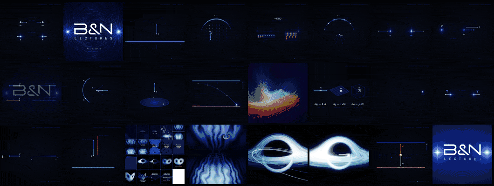
</p>

<p align="center">
  <a href="CATALOGO.md"><b>Full catalog</b></a> &nbsp;·&nbsp;
  <a href="https://github.com/4mser/bn-lectures"><b>B&N Lectures</b></a> &nbsp;·&nbsp;
  <a href="https://bnsolutions.cl/lectures"><b>bnsolutions.cl/lectures</b></a> &nbsp;·&nbsp;
  <a href="README.md">Leer en español</a>
</p>

Every B&N Lectures video is made of simulations: field lines integrated with RK4, a quantum packet crossing a double slit, a fluid born from that packet, light rays bending around a black hole. This library gathers all of them. There are 192 simulations and effects, taken from the Electricity and Magnetism series, the original reel and every version of the teaser, including the ones that had been lost and were rebuilt.

Each catalog entry has a thumbnail, what it shows with its equation or model, the file and function it came from, what it depends on and how easy it is to reuse. The most useful pieces are also copied into seven clean modules, ready to take to another project. The catalog and the module notes are written in Spanish.

### `// 01` What's here

| | |
|---|---|
| **[`CATALOGO.md`](CATALOGO.md)** | The 192 entries grouped by type, with thumbnail, equation, origin, dependencies and reusability, plus the version map: which code each video came from. |
| **`miniaturas/`** | One image per entry, taken from the video frame where the simulation shows. |
| **`modulos/`** | Seven reusable pieces, each with a `LEEME.md` that explains what it does and how to integrate it. |
| **`datos/` and `herramientas/`** | The catalog as Python data and the scripts that build `CATALOGO.md` and the thumbnails. |

### `// 02` A sample

<table>
  <tr>
    <td width="25%" valign="top">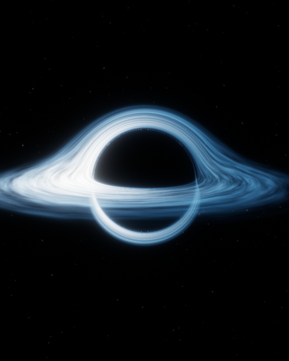<br><b>Black hole</b><br><sub>Schwarzschild-like bent rays, a disk with Doppler beaming and the photon sphere</sub></td>
    <td width="25%" valign="top">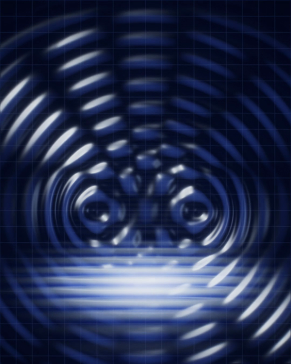<br><b>2D Schrödinger</b><br><sub>iψₜ = −½∇²ψ + Vψ by split-step Fourier, with diffraction and tunneling</sub></td>
    <td width="25%" valign="top">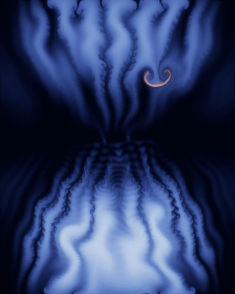<br><b>Stable fluids</b><br><sub>Incompressible 2D Navier-Stokes born from the quantum state via Madelung</sub></td>
    <td width="25%" valign="top">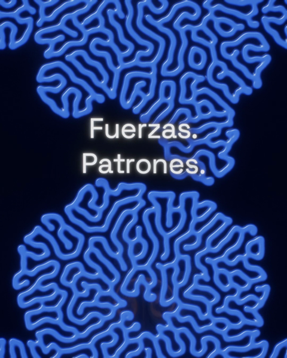<br><b>Gray-Scott</b><br><sub>Reaction-diffusion with F = 0.055 and k = 0.062, seeded with the fluid's ink</sub></td>
  </tr>
  <tr>
    <td width="25%" valign="top">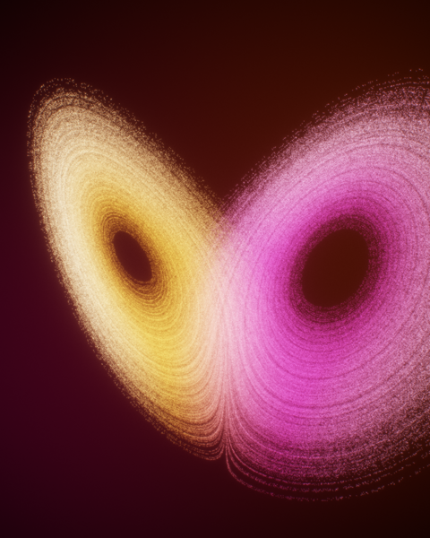<br><b>Lorenz attractor</b><br><sub>A million particles integrated with RK4 in a GPU texture</sub></td>
    <td width="25%" valign="top">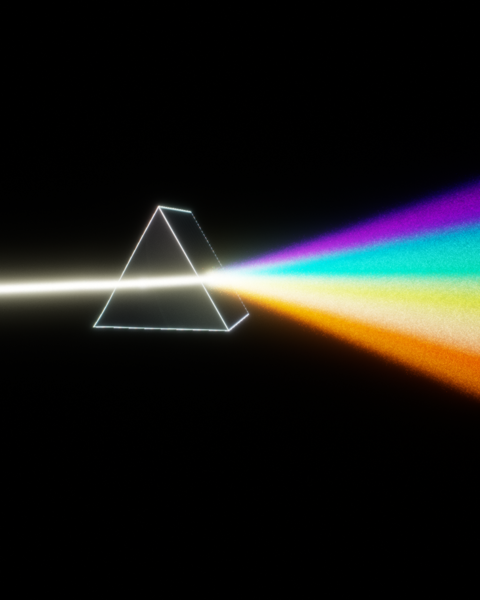<br><b>Prism</b><br><sub>Raymarched glass with Fresnel and a spectral fan</sub></td>
    <td width="25%" valign="top">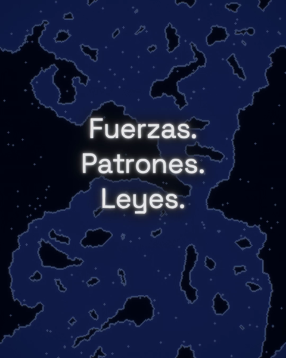<br><b>Ising model</b><br><sub>Checkerboard Metropolis below the critical temperature, with a growing field</sub></td>
    <td width="25%" valign="top">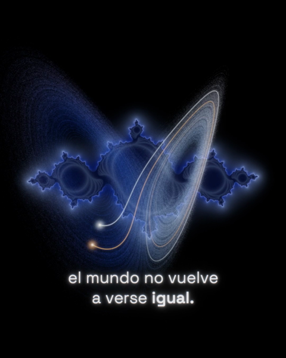<br><b>Julia set</b><br><sub>z ↦ z² + c, with c stepping forward on every beat</sub></td>
  </tr>
</table>

<table>
  <tr>
    <td width="50%" valign="top">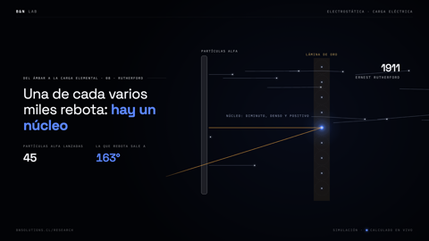<br><b>Rutherford scattering</b><br><sub>K/r² repulsion integrated with an adaptive step: one alpha in several thousand bounces back</sub></td>
    <td width="50%" valign="top"><br><b>Born and gone</b><br><sub>+2q and −q with twelve lines per unit of charge: half end at −q and the rest go to infinity</sub></td>
  </tr>
</table>

### `// 03` Categories

| Category | Entries | | Category | Entries |
|---|---|---|---|---|
| [Electric field](CATALOGO.md#campo-eléctrico) | 79 | | [Quantum](CATALOGO.md#cuántica) | 6 |
| [Endings and logo](CATALOGO.md#finales-y-logo) | 16 | | [Fractals](CATALOGO.md#fractales) | 6 |
| [Engines and post-processing](CATALOGO.md#motores-y-efectos-de-postproceso) | 16 | | [Computing and AI](CATALOGO.md#computación-e-ia) | 5 |
| [Typography and credits](CATALOGO.md#tipografía-y-créditos) | 15 | | [Chaos](CATALOGO.md#caos) | 4 |
| [Gravity and orbits](CATALOGO.md#gravedad-y-órbitas) | 13 | | [Fluids](CATALOGO.md#fluidos) | 2 |
| [Music and audio analysis](CATALOGO.md#música-y-análisis-de-audio) | 10 | | [Probability](CATALOGO.md#probabilidad) | 2 |
| [Waves](CATALOGO.md#ondas) | 9 | | [Geometry and topology](CATALOGO.md#geometría-y-topología) | 9 |

### `// 04` The modules

| Module | What it does | Needs |
|---|---|---|
| [`motor-gpu`](modulos/motor-gpu/LEEME.md) | WebGL2 engine: raymarched worlds (black hole, prism, waves, nebula, torus, fractal), up to a million particles, 3D strokes, bloom and ACES grade. Every frame comes from `estado(t, W, H)` | Remotion, Chrome with ANGLE |
| [`lic`](modulos/lic/LEEME.md) | LIC textures of the two-charge field, static and animated in a seamless 60-frame loop | numpy, imageio-ffmpeg |
| [`analisis-musica`](modulos/analisis-musica/LEEME.md) | From an mp3 to an event map (kick, snare, hats, sections, risers) at 30 fps, plus sync measurement on the finished mp4 | numpy, imageio-ffmpeg |
| [`final-epiciclos`](modulos/final-epiciclos/LEEME.md) | Fourier epicycles that draw a mark, particles landing on the logo and the field being revealed | 2D canvas, `ritmo.json` |
| [`simulador-v6`](modulos/simulador-v6/LEEME.md) | Chained, precomputed simulations: FDTD wave → Schrödinger → fluid → Gray-Scott → Ising | numpy |
| [`lab-serie`](modulos/lab-serie/LEEME.md) | The series' canvas engine: integrated field lines, particles, glowing charges and a canvas that adapts to 4:5, 16:9 and 9:16 | Remotion |
| [`musica`](modulos/musica/LEEME.md) | numpy music and effect generators, byte-for-byte deterministic, that write the wav and its event map | numpy |

### `// 05` Using a module

1. Read its `LEEME.md`: it says which project it came from, which files it brings and what it expects to find.
2. Copy the folder into your project. TypeScript modules go in `src/` of a [Remotion](https://www.remotion.dev) project; Python ones in `herramientas/` or `audio/`.
3. Install what it asks for. The Python scripts only need an environment with `numpy` and `imageio-ffmpeg` (and `pillow` for contact sheets); the TypeScript modules compile with `tsc --noEmit` as they are.
4. If the module depends on the music (`ritmo.json`), make yours with `analisis-musica` or one of the generators in `musica`.

For a new lesson, start from the template in [bn-lectures-clases](https://github.com/4mser/bn-lectures-clases/tree/main/plantilla), which already brings `lab-serie`, the fonts and the render tools. For something along the lines of the teaser, the full project is in [bn-lectures-teaser](https://github.com/4mser/bn-lectures-teaser).

### `// 06` Maintaining the catalog

```bash
python3 herramientas/catalogo.py                              # datos/catalogo.py → CATALOGO.md
BN_VIDEOS=<working folder> python3 herramientas/miniaturas.py      # re-extracts the thumbnails
```

To add an entry, add it to `datos/catalogo.py` and run both scripts. Paths in the «Dónde» column are relative to B&N's working folder, where the source projects live; the published ones are [the teaser](https://github.com/4mser/bn-lectures-teaser) and [the lessons](https://github.com/4mser/bn-lectures-clases).

### `// 07` Team

**Nicolás Moreno** · [@4mser](https://github.com/4mser) · [LinkedIn](https://www.linkedin.com/in/nicolasmorenoavila)<br>
Creative and technical director of B&N Lectures. In this library he designed and programmed:

- the physics simulators: 2D Schrödinger, fluids, Gray-Scott, field LIC, Chladni and Lorenz on the GPU;
- the canvas and WebGL2 animation engine most entries come from;
- the music analysis and the sync of every frame to the song;
- the catalog of 192 simulations, its thumbnails and the reusable modules.

**Benjamín Campos** · [@B3njjaman](https://github.com/B3njjaman)<br>
Co-founder of B&N Solutions. He made the original reel «De lo discreto a lo continuo» and the series' simulation engine, published here as the `lab-serie` module with his permission, under the same MIT license.

**Javier Patiño**<br>
Physics graduate and lecturer. Author of the Electricity and Magnetism notes and derivations the lessons are based on, and the voice of B&N Lectures.

### `// 08` License

Code and documentation are under the [MIT License](LICENSE), © 2026 B&N Solutions.

The B&N mark, its logo and the name «B&N Lectures» are not covered by MIT: they appear in `modulos/final-epiciclos/marca.json` and in some thumbnails, and remain with B&N Solutions ([TRADEMARKS.md](TRADEMARKS.md)). Techniques by other authors used in the modules (LIC by Cabral and Leedom and by Forssell, Stam's stable fluids, Gray and Scott, Lorenz) are cited in the catalog.

---

<p align="center">
  
</p>
